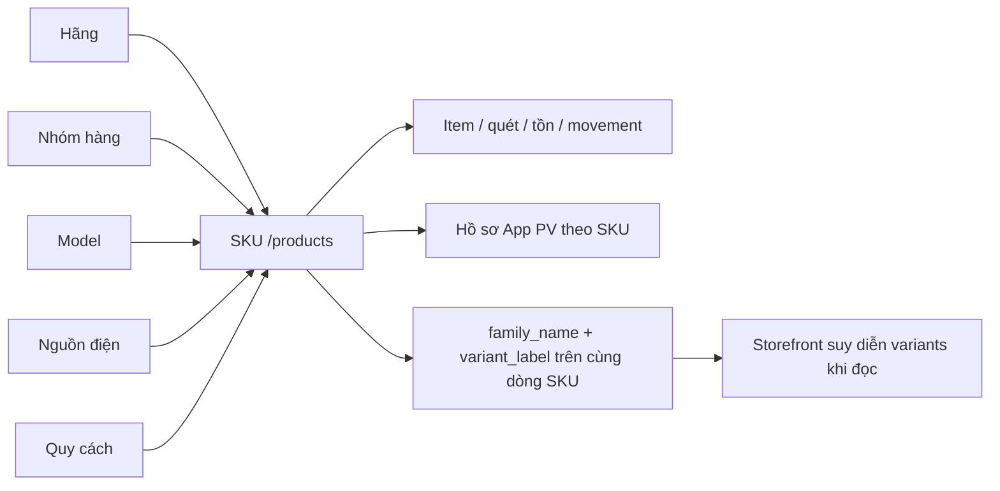

# Phân tích V1 ↔ backend ↔ ảnh V2 Hoa Nam

> Tài liệu đồng hành với [quy tắc giao diện V2](HOA_NAM_V2_PREVIEW_DETAIL_RULES.md). Mục đích: phân biệt thực thể và API đang có với dữ liệu mà ảnh V2 vẽ ra, làm cơ sở nâng cấp mà không mất chức năng. Ngày đối chiếu: 02/11/2026. Đây là **phân tích mã nguồn tĩnh**, chưa xác nhận schema/data của môi trường triển khai.

## 1. Mốc mã nguồn và độ tin cậy

| Nguồn | Mốc đã đọc | Vai trò |
| --- | --- | --- |
| Frontend hiện tại | `WMS_Warehouse_Hoa_Nam_FE`, branch `fix/inventory-page-size-height-20261031` | Route, màn, type, payload và đường gọi API của V1 đang chuẩn bị nâng cấp. |
| Backend nền dùng để so sánh | worktree `_backend_dev_latest`, HEAD `29663d1d` ngày 01/11/2026; các file sản phẩm/kho đối chiếu **không khác** branch `dev` tại `b1f12af4` | Schema, route, request, controller và read model mới hơn. Worktree này có sửa auth chưa commit, không liên quan kết luận product/SKU. |
| Backend worktree gốc | `WMS_Warehouse_Hoa_Nam_BE`, branch `fix/auth-cookie-session-be`, HEAD `c3f006d2` ngày 30/10/2026 | Snapshot nhánh khác, **không có** `ProductMaster`/`Sku` module mới. Không lấy tên thư mục gốc để kết luận thiếu chức năng ở `dev`. |
| Ảnh V2 | `Hoa_Nam_UIUX_V2` — 23 nhóm/516 PNG | Ý định trình bày và trạng thái. Số KPI, mã `SP-HN-*` và tên trong ảnh là minh họa, không chứng minh BE đã có bản ghi tương ứng. |

Các đường dẫn và nhánh trong tài liệu là bằng chứng **tại thời điểm đọc**. Không dùng tài liệu này để suy ra DB production đã chạy đủ migration, API đã được deploy hoặc quyền đã được cấp trong dữ liệu thật. Trước khi viết UI mới cần kiểm tra môi trường đích và contract thực tế.

## 2. Kết luận trực tiếp về “một sản phẩm gốc có nhiều SKU”

1. **V1 frontend quản lý SKU độc lập.** `/master-data/skus` đọc/ghi `/products` (tên endpoint tương thích cũ, controller ghi rõ đây là danh sách SKU). Form và `SkuPayload` có mã/tên/loại/đơn vị/5 master/tracking/trạng thái/định mức/công bố, **không có `product_root_id`, `family_id`, `family_name` hoặc danh sách SKU liên kết**. `/master-data/catalog` là 5 tab thuộc tính, không tạo bản ghi sản phẩm gốc.
2. **`ProductMaster` backend không phải sản phẩm gốc của ảnh.** Bảng `product_masters` có `master_type = BRAND | CATEGORY | MODEL | PACKAGE | POWER`, `code`, `name`, `parent_master_id`, `status`. Nó là danh mục thuộc tính cho SKU, đồng bộ với 5 bảng canonical. Dùng bảng/API này cho màn `SP-HN-001` sẽ sai nghĩa và có thể phá FK/triggers đang phục vụ SKU.
3. **Backend `dev` có nhóm biến thể dạng suy diễn.** Mỗi dòng SKU có tối đa một `family_name` và một `variant_label`. Read model storefront gom các SKU **cùng hãng + cùng nhóm hàng + cùng tên family** thành danh sách `variants`; SKU thiếu `family_name` thành nhóm một SKU. Không có bảng/khóa/mã/trạng thái/version riêng cho “sản phẩm gốc”. Cách biểu diễn này cho phép **một SKU thuộc tối đa một family suy diễn tại một thời điểm**, không biểu diễn SKU thuộc nhiều sản phẩm gốc đồng thời. Đây là kết luận từ schema/cách truy vấn, **không phải quyết định nghiệp vụ mới của khách**.
4. Nhóm family hiện phục vụ **storefront công khai `/api/v1/public/products`** và import catalog App PV dạng JSON. API App PV `/api/v1/pv/products` hiện vẫn trả **mỗi SKU là một sản phẩm công khai**, không trả danh sách sản phẩm gốc với mã `SP-HN-*`. Danh sách `/products` nội bộ cũng phân trang theo SKU, không theo family.
5. **Chưa có backend cho màn “Danh mục sản phẩm gốc” V2 đúng nghĩa.** Ảnh yêu cầu mã sản phẩm gốc, trạng thái, đơn vị, số SKU liên kết, người/cập nhật, tạo/sửa/ngừng và chi tiết liên kết. `family_name` có thể hỗ trợ đọc nhóm hiện có, nhưng không cung cấp định danh ổn định, CRUD hoặc quy tắc ngừng sản phẩm gốc.

### Sơ đồ dữ liệu hiện hành

Không có cạnh `SKU → product_root_id` hay bảng liên kết `product_root_sku` trong contract đã đọc. Cột legacy tên `product_id` ở chứng từ/tồn trỏ về **SKU**, không chứng minh có bảng sản phẩm gốc.

## 3. Chứng cứ chi tiết về danh mục và SKU

| Lớp | Mã hiện có | Kết luận khi so V2 |
| --- | --- | --- |
| V1 route | `src/shared/constants/routes.ts`: `/master-data/skus`, `/master-data/catalog`, `/master-data/pv-products`; `src/app/layouts/nav-data.ts` | SKU, 5 master và hồ sơ PV là ba bề mặt riêng. Màn `Danh mục sản phẩm` V2 cần route/contract riêng theo quyết định người dùng; 5 tab chuyển thành `Danh mục thuộc tính`. |
| V1 SKU service | `src/modules/master-data/services/mvp-master.service.ts`: `getMvpSkus`, `createMvpSku`, `updateMvpSku` dùng `API_ENDPOINTS.PRODUCTS = /products`; trước update kiểm tra tồn/movement và gửi `If-Match` + idempotency | Đổi layout không được đổi payload SKU, bỏ khóa định danh hoặc dùng family suy diễn để ghi SKU. |
| V1 SKU type | `src/modules/master-data/types/mvp-master.types.ts`: `SkuRecord`, `SkuPayload` | Có 5 FK thuộc tính, `version_code`, `is_serial_tracked`, `published_to_app`, `min_stock/max_stock`; không có mã/quan hệ sản phẩm gốc. |
| V1 5 tab | `src/modules/master-data/services/catalog-master.service.ts`: `BRAND`, `CATEGORY`, `MODEL`, `POWER_SOURCE`, `PACKAGE` gọi 5 endpoint canonical | Tách trang là thay điều hướng/UI, **không phải di chuyển dữ liệu**. Giữ code/name/description/sort/status và Model–Hãng. |
| BE `ProductMaster` | `Modules/Warehouse/database/migrations/2026_01_01_000030_create_product_masters_table.php`; `ProductMasterController.php` | `master_type` chỉ có 5 loại thuộc tính. `/product-masters` là compatibility/catalog API; frontend 5 tab hiện gọi các bảng canonical trực tiếp. |
| BE SKU | `Modules/Warehouse/app/Models/Sku.php`; migration `2026_01_01_000031_create_products_table.php` và `2026_08_31_000000_add_hand_tools_family_variant_columns.php` | PostgreSQL dùng bảng vật lý `skus`, view `sku` để tương thích; mã SKU duy nhất. `family_name`/`variant_label` là cột nullable trên SKU, không phải FK. Khi thay schema/view/trigger phải bảo toàn tất cả cột hiện hành. |
| BE CRUD SKU | `/api/v1/products`, `/api/v1/skus` alias; `ProductController.php`, `CurrentBaselineSkuController.php`, `StoreProductRequest.php`, `UpdateProductRequest.php` | `ProductController::index` ghi rõ “Danh sách SKU”. Form request chuẩn không nhận `family_name`/`variant_label`; tự thêm hai field vào form V2 mà không sửa contract sẽ không lưu được. |
| BE family đọc | `PublicCatalogReadModel::siblingRows/variantsOf/familyContext` | Nhóm bằng `family_name` + brand/category; chỉ lấy SKU public hợp lệ. Count trong `/public/products` là số SKU, không phải số sản phẩm gốc. |
| BE family ghi | `PvCatalogImportService.php` và migration family | Import JSON catalog có thể ghi `family_name`/`variant_label`; `variant_label` không có family bị từ chối. **Import SKU Excel thường** là luồng riêng và không tự tạo family. |
| BE PV | `PvPublicCatalogController.php`, `PvCatalogReadModel.php`, `routes/api.php` | `GET /api/v1/pv/products/{skuId}` **đã có**. Nó trả chi tiết SKU đã publish, 404 cả khi không tồn tại/chưa publish, whitelist dữ liệu public + freshness. FE route chi tiết công khai đã gỡ; phục hồi frontend có thể tận dụng endpoint này, nhưng nó vẫn là chi tiết **SKU**, không phải sản phẩm gốc nhiều SKU. |

### Giới hạn của family suy diễn

- Một SKU có đúng một `brand_id`, một `category_id` và một `family_name` nullable. Vì vậy ở mô hình đang có, **một SKU không nằm đồng thời ở hai family**. Đổi hãng/nhóm/tên family sẽ đổi nhóm khi đọc; không có lịch sử hay ID family cố định để giữ deep link.
- Hai family cùng tên nhưng khác hãng/nhóm là hai nhóm khác nhau. Nếu cần mã `SP-HN-001`, trạng thái hoặc quyền sửa ở cấp sản phẩm gốc, không thể lấy `family_name` làm khóa an toàn.
- Một family có thể chứa SKU `ACTIVE`/`INACTIVE`, public/unpublished, đơn vị khác nhau. API storefront lọc theo public trước khi đếm `variants`, nên số biến thể public **không bằng** số SKU nội bộ liên kết. KPI V2 phải định nghĩa rõ phạm vi.
- `ProductMaster` thuộc tính và `family_name` là hai cơ chế khác nhau. Đổi tên 5 tab thành “Sản phẩm gốc” không tạo được thực thể sản phẩm gốc.

## 4. Đối chiếu backend cho 23 nhóm giao diện

Các endpoint dưới đây là **đường chính để truy vết**, không phải bản sao đầy đủ của route list. FE route nằm trong `src/shared/constants/routes.ts` và `src/shared/api/endpoints.ts`; BE route/permission nằm trong `Modules/Warehouse/routes/api.php` cùng `routes/import.php`, `routes/governance.php` và `routes/public_api.php`. Tất cả endpoint WMS nội bộ dưới prefix `/api/v1` nếu không ghi khác.

| Nhóm V2 | Bề mặt V1/BE hiện có | Đối chiếu khi nâng V2 |
| --- | --- | --- |
| `tongquanhethong` | FE `/dashboard`; BE `/reports/dashboard-overview`, `/reports/dashboard-quick`, movement/cảnh báo định mức | KPI là projection từ tồn/phiếu/cảnh báo, không có bảng “dashboard” để điền số ảnh. Giữ lỗi từng phần và phạm vi quyền/kho. |
| `danhmuc_danhsachSKU` | FE `/master-data/skus`; BE `/products`/`/skus`, `/skus/import-excel`, `/pv/products/{id}/publish` | Mỗi hàng là SKU. Import Excel có dry run/commit/report và quyền `sku.manage`; publish dùng `pv.publish` và version hồ sơ PV riêng. Không trộn hai version. |
| `danhmuc_danhsachsanpham` | **Chưa có endpoint root product**; `ProductMaster`/`family_name` không tương đương | Cần contract riêng trước khi hiển thị mã `SP-HN-*`, số SKU liên kết, tạo/sửa/ngừng. Không dùng `/products` nếu muốn đếm sản phẩm gốc: endpoint này đếm SKU. |
| `danhmuc_dailynoinhan` | `/agencies` và alias `/recipients`; `BaM1RecipientController` | Một resource recipient có loại, vùng/thị trường/liên hệ; ngừng bằng `status=INACTIVE`, không DELETE. Giữ liên kết phiếu xuất và quyền. |
| `danhmuc_benhloi` | `/defects` và `/defect-catalogs`; `DefectCatalogController` | Ngừng bằng status để hồ sơ bảo hành cũ giữ FK; giữ code/name/description/version. |
| `danhmuc_appPV` | Nội bộ `/pv-admin/resources/*`, `/pv/products/{id}/publish`; công khai `/pv/products`, `/pv/products/{skuId}`; storefront khác `/public/products` | Hồ sơ/ảnh/tag/ngành/công bố gắn SKU. Public App PV có endpoint chi tiết theo SKU; FE cần route chi tiết. Storefront `family/variants` là bề mặt khác, không tự đổi API App PV. |
| `hoanam_authen` | `/auth/login`, `/auth/me`, `/auth/refresh`, `/auth/change-password`, `/auth/forgot-password`, `/auth/verify-otp`, `/auth/reset-password`, `/auth/mfa/*` | Giữ luồng V1 theo yêu cầu. Ảnh V2 là nguồn trạng thái nhìn thấy, không thay quy tắc phiên/OTP/MFA/403. |
| `nhapkho.phieunhapkho` | `/inbound-documents`, `/scans`, `/lines/{lineId}/sku`, `/post-receipt`, `/cancel`, scan entries/attachments | Chứng từ header-only, dòng/số lượng phát sinh từ quét. Chỉ Post hợp lệ mới tăng tồn; SKU thiếu tên/đơn vị bị chặn. Kho/data scope ở middleware. |
| `nhapkho.linhkienxepkhay` | `/putaway-tasks`, `/containers`, `/putaway/history` | BOX→TRAY là lifecycle vị trí, **stock-neutral**. Giữ tạo/xác nhận/hủy, chặn trùng, thiếu khay và quyền chỉ xem. |
| `xuatkho.phieuxuatNFC` | `/outbound-request-imports` (Excel/manual), `/outbound-documents`, `/scans`, `/post-issue`, `/packing-labels/*`, `/items/{itemId}/rfid` | Ảnh phần lớn là read/NFC sau xuất; BE vẫn có chuỗi tiếp nhận→match→nhãn→Post. RFID tùy chọn; Post mới trừ tồn. Không bỏ màn thao tác vì V2 ít ảnh của bước đó. |
| `tonkho_tracuu.doisoat` | `/inventory/balances`, `/subledger`, `/stock-movements`, `/reports/inventory-reconciliation` | Tồn projection + ledger, theo kho/BOX/TRAY/mã; data scope thật. Không thêm sửa tồn trực tiếp từ UI. |
| `tonkho_phieudao` | `/reversal-documents`, `/{id}/confirm`, `/{id}/post`, `/{id}/cancel`, attachment | Chỉ Post phiếu đảo tạo movement đối ứng; giữ nguồn chứng từ, version, idempotency và chặn phụ thuộc. |
| `baohanh.linhkien_hosobaohanh` | `/warranty-cases`, `/{id}/status`, events, attachments | Có mã hoặc TEMP_ONLY, PII masking, nhiều bệnh lỗi và lifecycle; ảnh V2 không liệt kê hết field. |
| `baohanh.linhkien_phieuxuatlinhkien` | `/warranty-component-issues`, scans/lines/post/cancel | Gắn case bảo hành; stock effect chỉ khi Post. Cần giữ nguồn BOX/serial và scope kho. |
| `baocao_nhapkho` | FE `/reports/inventory-flow`; BE `/reports/inventory-xnt*`, `/reports/document-history`, `/reports/inventory-ledger` | Báo cáo đọc từ chứng từ/movement đã Post; export là quyền riêng. |
| `baocao_xuatkho` | FE `/reports/outbound-flow`; BE `/reports/document-history`, `/reports/inventory-ledger`, `/reports/label-log` | Phân biệt đang quét với đã Post và lỗi nhãn, không cộng nhầm vào xuất tồn. |
| `baocao_tonkho.doisoat` | FE `/reports/stock-reconcile`; BE `/reports/inventory-balance`, `/reports/inventory-xnt`, `/reports/inventory-reconciliation` | Dùng nguồn tồn/ledger/đối soát đúng kỳ, không lấy số screenshot. |
| `baocao_truyvethanghoa` | FE `/reports/traceability`; BE `/reports/movement-trace`, `/stock-movements/trace-by-code` | Liên kết mã vật lý, serial, chứng từ và movement; phân biệt mã có nhưng chưa có sự kiện. |
| `baocao_doichieudulieu` | FE `/reports/import-quality`; BE `/reports/import-match` + export | Lỗi từng dòng/đợt nhập và nguồn Excel; export đúng phạm vi/quyền. |
| `baocao_nhan.donggoi.inlai` | FE `/reports/packing-label`; BE `/reports/label-log`, label print events/snapshots | Lịch sử mỗi lần in, xem trước/in lại, kết quả in chưa xác định; in lại không đổi tồn. |
| `baocao_baohanhlinhkien` | FE `/reports/warranty`; BE `/reports/warranty-defects`, `/reports/warranty-component-usage` | Hồ sơ, linh kiện, ngày cảnh báo, ảnh/video với masking/quyền. |
| `baocao_xuattheodaily` | FE `/reports/recipient`; BE `/reports/outbound-by-agency`, `/reports/outbound-by-recipient` | Một người nhận có nhiều phiếu; hoàn trả phải dựa trên phiếu đảo/nguồn thật. |
| `baocao_lichsunhapxuat` | FE `/reports/pending-evidence`; BE `/reports/document-history`, `/reports/inventory-ledger`, document attachments | Lịch sử nhập/xuất/đảo và chứng cứ; mở được chứng từ gốc. |

**Đọc bảng đúng phạm vi:** một màn V2 có thể tổng hợp nhiều endpoint. Việc endpoint tồn tại không chứng minh màn đã dùng hết field/trạng thái; cần kiểm tra FE hook/service và payload khi triển khai từng màn. Các route không có ảnh V2 (IAM, cấu hình kho, profile/MFA, audit, scan, NFC riêng, PV admin phụ trợ…) vẫn phải giữ.

## 5. Bất biến backend ảnh hưởng trực tiếp đến giao diện

| Bất biến | Bằng chứng mã nguồn | Quy tắc UI V2 |
| --- | --- | --- |
| SKU là đơn vị vận hành kho | `sku`/`skus`, chứng từ có `product_id` legacy trỏ SKU; `ProductController` gọi `/products` là SKU | Sản phẩm gốc mới không được thay `sku_id` trong phiếu/tồn/movement. |
| Khóa định danh sau khi có stock/movement | FE `hasMvpSkuStock`, BE `ProductController::assertImmutableAfterStock` | Form V2 phải khóa mã SKU/tracking mode hoặc báo lỗi đúng, kể cả ở tab Chi tiết. |
| Version và idempotency | FE gửi `If-Match`/`Idempotency-Key`; BE có `sku.version`, PV profile version và guard 412/428 | Không dùng version SKU cho publish PV hoặc bỏ header khi đổi component. |
| Ngừng dùng, không xóa master | API master/agency/defect dùng PATCH status; lịch sử giữ FK | Nút V2 “Ngừng sử dụng” không phải DELETE vật lý. |
| Nhập/xuất full post | `post-receipt`, `post-issue`; scan/label/putaway không ghi movement xuất/nhập | Preview/action bar phải phản ánh điều kiện Post, không trừ tồn khi scan/in/gắn tag. |
| Nhãn kiện là gate xuất | `AlignedOutboundFlowController`, các route `POST /outbound-documents/{id}/packing-labels/{labelId}/{action}` với action `preview`, `ready`, `print`, `reprint` | Không bỏ preview/ready/print/xác nhận dán khi làm lại Chi tiết phiếu. |
| RFID tùy chọn | `/outbound-documents/{id}/items/{itemId}/rfid`, Barcode/QR fallback trong luồng | Tab NFC V2 không khóa Post nếu chưa có UID khi các gate khác đã đạt. |
| Reversal append-only | `/reversal-documents/{id}/post` và `stock_movements` | Không cho “sửa số tồn” trực tiếp trong màn tồn/đối soát. |
| Public PV chỉ có whitelist | `PvCatalogReadModel::presentMany`, endpoint `getPvProduct` | Chi tiết App PV V2 chỉ dùng DTO public; unpublished/không tồn tại cùng 404, có freshness. |
| Quyền route và data scope | `routes/api.php` gắn permission + `Enforce*WarehouseScope` | Ẩn nút là UX; BE vẫn là nguồn phân quyền. Preview không được đọc kho ngoài scope. |

**Lưu ý về kiểm kê:** migration mở rộng lịch sử có thể tạo bảng tên `stocktake_*`, nhưng route/FE/SRS MVP hiện không cung cấp phiên kiểm kê hay điều chỉnh tồn trực tiếp. Không lấy sự tồn tại của bảng migration để tự thêm chức năng V2.

## 6. Phương án xây “Danh mục sản phẩm gốc” V2

| Phương án | Làm được | Giới hạn/rủi ro | Đánh giá |
| --- | --- | --- | --- |
| A. Chỉ dựng màn đọc từ `family_name` hiện có | Liệt kê nhóm biến thể của một phần SKU và xem SKU cùng nhóm, không đổi schema | Không có mã `SP-HN-*`, ID ổn định, status/version/CRUD; SKU thường thiếu family; đổi tên/hãng/nhóm làm đổi khóa; unit/trạng thái/updated-by cấp nhóm không xác định | Chỉ phù hợp **prototype đọc**, không đáp ứng toàn bộ ảnh V2. |
| B. Thêm thực thể sản phẩm gốc và FK nullable trên SKU | Mã/tên/trạng thái/đơn vị/version riêng; một sản phẩm gốc có nhiều SKU; count/query/CRUD rõ; SKU cũ vẫn hoạt động | Cần thiết kế API/quyền, backfill có kiểm tra, quy tắc ngừng khi có SKU; phải rà mọi serializer/import | **Khuyến nghị nếu triển khai đầy đủ V2.** Phù hợp mô hình hiện có: mỗi SKU thuộc tối đa một family suy diễn. |
| C. Bảng liên kết nhiều–nhiều | Một SKU có thể thuộc nhiều sản phẩm gốc | Không có nhu cầu/chứng cứ hiện tại; count, trạng thái, PV, tìm kiếm và quản trị liên kết phức tạp hơn | Chỉ chọn nếu khách xác nhận nghiệp vụ cụ thể. |

Phương án B là **đề xuất kỹ thuật để thảo luận**, không phải quyết định đã triển khai. Tên bảng/route chính thức cần thống nhất với BE/FE/BA. Hình dạng tối thiểu nên được đặc tả trước khi code:

- Sản phẩm gốc có ID bất biến, `code` duy nhất, `name`, nhóm/hãng nếu nghiệp vụ cần, đơn vị mặc định **nếu** các SKU liên kết có thể dùng chung, `status`, `version`, người/thời điểm tạo/sửa. Quy định rõ code `SP-HN-*` do ai cấp và có được đổi sau khi đã liên kết SKU hay không.
- SKU giữ nguyên `sku_id`/`sku_code` và mọi FK/movement hiện có, thêm liên kết nullable tới sản phẩm gốc. SKU chưa phân nhóm vẫn dùng được; không ép import/scan hiện hành phải có sản phẩm gốc ngay.
- API đọc list/detail trả `linked_sku_count` theo **dữ liệu thật và phạm vi được định nghĩa**; API sửa liên kết có validation chống trùng/chuyển sai, version/If-Match và audit. Không lấy `family_name`/tên SKU làm khóa ngoại.
- Quy tắc khi ngừng sản phẩm gốc phải chốt: có được giữ SKU ACTIVE, tồn hiện hữu, phiếu cũ, hồ sơ PV đang publish hay không. Không tự chuyển tất cả SKU/phiếu sang INACTIVE vì thao tác ở cấp nhóm.
- Backfill chỉ liên kết các nhóm có thể xác minh. Với `family_name` trùng/thiếu hoặc nhóm có unit/status không đồng nhất, đưa vào danh sách cần rà soát; không tự gộp bằng tên gần giống. Giữ `family_name` cũ cho compatibility cho tới khi các consumer `/public/products` được chuyển an toàn.
- Regression phải chứng minh: tạo/sửa/nhập Excel SKU, nhập/xuất, tồn, bảo hành, PV, 9 báo cáo và deep link cũ vẫn dùng `sku_id` như trước; tạo/sửa/ngừng sản phẩm gốc **không** thay tồn hoặc movement.

### Trường ảnh V2 so với backend hiện có

| Trường/hành động ở `danhmuc_danhsachsanpham` | Hiện trạng backend `dev` | Việc cần làm |
| --- | --- | --- |
| Mã sản phẩm gốc `SP-HN-*` | Không có cột/ID cho root product; `sku_code` là mã SKU | Thiết kế code/ID riêng, không dùng `sku_code`. |
| Tên và nhóm sản phẩm gốc | `family_name` nullable trên SKU; category/brand FK theo SKU | Xác định nguồn dữ liệu gốc và quy tắc khi SKU khác nhau. |
| Đơn vị tính ở cấp sản phẩm gốc | `unit` theo SKU | Chốt đơn vị mặc định hoặc bỏ khỏi root nếu có nhiều unit. |
| Số SKU liên kết | Có thể đếm family suy diễn cho một số SKU, nhưng không có FK root | Đếm bằng quan hệ thật, định nghĩa tính cả INACTIVE hay không. |
| Trạng thái/ngừng sử dụng root | `status` chỉ ở SKU/master thuộc tính | Thiết kế status riêng và tác động đến SKU/PV; không dùng status SKU đầu tiên. |
| Người/thời gian cập nhật root | SKU có `updated_at`, audit theo SKU; không có root audit | Tạo audit/mốc cập nhật riêng. |
| Tạo/sửa/chi tiết root, tab SKU liên kết | Chưa có route/controller root | API CRUD + list liên kết + permission + version/idempotency. |

## 7. Gợi ý thứ tự tích hợp và kiểm tra

1. **Xác nhận môi trường backend đích** đang theo `dev` nào, migration nào đã chạy và route nào thực sự bật. Phân biệt worktree `WMS_Warehouse_Hoa_Nam_BE` cũ với code `dev` mới; không suy từ tên thư mục.
2. **Đóng hợp đồng root product** (ID/code, cardinality, status, unit, liên kết SKU, quyền) rồi mới tạo màn `Danh mục sản phẩm` mới. Giữ `/master-data/catalog` cho 5 tab ở `Danh mục thuộc tính` hoặc alias tương thích.
3. **Đồng bộ App PV chi tiết:** backend `GET /api/v1/pv/products/{skuId}` đã có; FE cần route/nút mở chi tiết và trạng thái 404/freshness. Kiểm tra đây là chi tiết SKU public, không lấy nhầm API storefront `/api/v1/public/products/{slug}` nếu chưa định đổi contract.
4. **Bảo toàn luồng SKU:** import Excel chỉ ở Danh sách SKU theo quyết định người dùng; giữ dry run, commit, report lỗi, quyền và khóa định danh. PV catalog JSON import là công cụ khác, không thay nút Excel SKU.
5. **Triển khai từng miền và test contract:** so request/response và quyền trước/sau; các luồng nhập/xuất/đảo phải đối chiếu movement/tồn và idempotency. Với báo cáo, đối chiếu nguồn kỳ/kho và quyền export. Ảnh V2 chỉ kiểm tra bố cục/trạng thái.

### Nguồn mã trực tiếp để mở khi triển khai

- FE: [routes.ts](../../src/shared/constants/routes.ts), [API endpoints](../../src/shared/api/endpoints.ts), [SKU types](../../src/modules/master-data/types/mvp-master.types.ts), [SKU service](../../src/modules/master-data/services/mvp-master.service.ts), [5 master service](../../src/modules/master-data/services/catalog-master.service.ts), [SKU Excel modal](../../src/modules/master-data/components/SkuImportModal.tsx).
- BE danh mục: [ProductMaster migration](../../../_backend_dev_latest/Modules/Warehouse/database/migrations/2026_01_01_000030_create_product_masters_table.php), [SKU migration](../../../_backend_dev_latest/Modules/Warehouse/database/migrations/2026_01_01_000031_create_products_table.php), [family migration](../../../_backend_dev_latest/Modules/Warehouse/database/migrations/2026_08_31_000000_add_hand_tools_family_variant_columns.php), [ProductController](../../../_backend_dev_latest/Modules/Warehouse/app/Http/Controllers/ProductController.php), [ProductMasterController](../../../_backend_dev_latest/Modules/Warehouse/app/Http/Controllers/ProductMasterController.php), [PV catalog import](../../../_backend_dev_latest/Modules/Warehouse/app/Services/PvCatalogImportService.php).
- BE public: [PvPublicCatalogController](../../../_backend_dev_latest/Modules/Warehouse/app/Http/Controllers/PvPublicCatalogController.php), [PvCatalogReadModel](../../../_backend_dev_latest/Modules/Warehouse/app/Services/PvCatalogReadModel.php), [PublicCatalogReadModel](../../../_backend_dev_latest/Modules/Warehouse/app/Services/PublicCatalogReadModel.php), [API routes](../../../_backend_dev_latest/Modules/Warehouse/routes/api.php), [storefront routes](../../../_backend_dev_latest/Modules/Warehouse/routes/public_api.php).

## 8. Phạm vi kết luận

Từ V1 và backend `dev` hiện đọc được, câu trả lời thực tế cho quan hệ là: **mỗi SKU chỉ có thể thuộc tối đa một nhóm family suy diễn tại một thời điểm; chưa có quan hệ tới “sản phẩm gốc” có ID riêng.** Thiết kế một SKU thuộc nhiều sản phẩm gốc sẽ là thay đổi nghiệp vụ/schema mới. Bản nâng cấp V2 cần giữ 5 tab thuộc tính và SKU hiện hữu, đồng thời đặc tả thực thể sản phẩm gốc trước khi triển khai màn tạo/sửa/ngừng.
